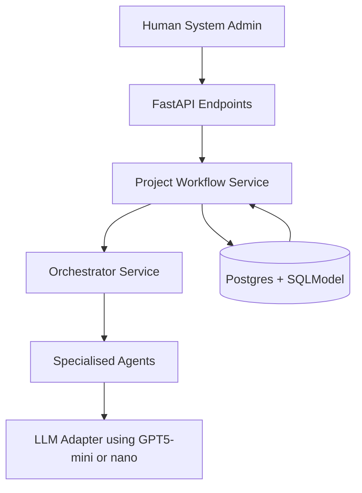

# Multi-Agent Orchestrator Platform

### *Autonomous AI-Driven Software Project Scaffolding*

🤖 🤖 🤖

A modular, extensible **AI Agent Framework** designed to automate the **entire early-stage software development workflow**, producing:

* Fully-refined project requirements
* Complete user story catalogues
* ERD + Class Diagrams
* Backend file/directory structure
* Code skeletons (FastAPI, SQLModel, services, adapters, tests)
* Test scaffolds
* A full Technical Lead review

All produced **step-by-step**, with **minimal LLM cost**, and **maximum human oversight**.

The platform acts like a virtual software team: **Product Owner → Architect → Backend Developer → QA → Technical Lead**, all powered by pluggable LLM adapters such as **GPT-5-mini** and **GPT-5-nano**.

---

# 🔥 **Core Purpose**

The system mirrors what you currently achieve manually with ChatGPT:

> *“Give requirements → answer PO questions → produce user stories → draft diagrams → generate code skeletons → review → refine → prepare tests.”*

But now:

✔️ Fully automated
✔️ Broken into explicit steps
✔️ Persisted state
✔️ One LLM call per step → **lowest possible cost**
✔️ Human-in-the-loop where required
✔️ Ready to generate a complete project scaffold

---

# 🚀 **Key Features**

### **🧩 1. Modular Agent Workforce**

Each AI Agent is a specialised worker with its own role, prompt system, and capabilities:

| Agent Role                  | Responsibilities                                                                             |
| --------------------------- | -------------------------------------------------------------------------------------------- |
| **Product Owner Agent**     | Requirements Q&A loop, summarisation, functional & non-functional requirements, user stories |
| **System Architect Agent**  | ERD diagrams (Mermaid), class diagrams, architectural notes                                  |
| **Backend Developer Agent** | File tree generation, code skeletons, unit test skeletons                                    |
| **QA Tester Agent**         | Regression scenarios, testing strategy *(optional extension)*                                |
| **DBA Agent**               | Schema evaluations, indexing strategies *(optional)*                                         |
| **DevOps Agent**            | Incident advice, deployment models *(optional)*                                              |
| **Technical Lead Agent**    | Reviews all artefacts, feedback summary, final approval                                      |

Agents are **hot-swappable** and communicate through a shared orchestrator.

---

### **🧠 2. Cost-Optimised LLM Pipeline**

To minimise OpenAI costs without degrading quality:

* **GPT-5-mini** → High-reasoning tasks (stories, diagrams, skeletons, reviews)
* **GPT-5-nano** → Cheap tasks like routing or basic analysis
* Each step is **separate**, not a giant single prompt
* A full project skeleton can be generated for **a few cents**

---

### **⚙️ 3. Step-Driven Development Workflow**

A finite-state workflow controls the entire lifecycle:

```
1. REQUIREMENTS_QA
2. USER_STORIES
3. ARCHITECTURE
4. FILE_TREE
5. CODE_SKELETON
6. TEST_SKELETON
7. TECH_LEAD_REVIEW
8. DONE
```

Each step:

* Uses exactly **one LLM call**
* Stores output in `WorkflowStateDB.artefacts`
* Advances to the next phase
* Provides clear API access for humans or automation

---

### **🗄 4. SQLModel + Postgres Persistence**

The platform stores:

* Sessions
* Tasks
* Agent outputs
* Message history
* Workflow state (phase + artefacts)

This enables:

* Full audit trails
* Agent debugging
* Human review injection
* Workflow retries / restarts

---

### **🧩 5. Domain-Driven, SOLID Architecture**

Clean and extensible project layout:

```
app/
  agents/
  domain/
  services/
  adapters/
  api/
  core/
  tests/
```

Interfaces, dependency injection, clear service boundaries, and LLM adapters ensure maintainability and scalability.

---

# 🏗 **High-Level Architecture**



---

# 📦 **Installation & Setup**

### **Clone the repository**

```bash
git clone https://github.com/clintonshane84/MFAOrchestrator
cd multi-agent-orchestrator
```

### **Create environment**

```bash
python3.11 -m venv .venv
source .venv/bin/activate
pip install -r requirements.txt
```

### **Run database migrations**

```bash
alembic upgrade head
```

### **Start the API**

```bash
uvicorn app.main:app --reload
```

---

# 🔌 **OpenAI Integration**

The system uses the **OpenAI API via LLM Adapters**, allowing:

* Model selection per agent
* Configuration via environment variables
* Easy swapping to other providers (Anthropic, Groq, local models)

Configuration:

```
OPENAI_API_KEY=...
OPENAI_MODEL_DEFAULT=gpt-5-mini
OPENAI_MODEL_ROUTING=gpt-5-nano
```

---

# 🧪 **Running Tests**

```bash
pytest -q
```

---

# 📡 **Workflow API Usage**

## **1️⃣ Start a workflow**

```bash
POST /workflows/start
{
  "created_by": "john",
  "initial_requirements": "I need a system for managing ambulance callouts..."
}
```

Response:

```json
{
  "id": "workflow-123",
  "current_phase": "requirements_qa",
  "artefacts": { ... }
}
```

---

## **2️⃣ Advance workflow one step**

```bash
POST /workflows/{id}/next-step
```

If still in Requirements Q&A:

```bash
POST /workflows/{id}/next-step
{
  "customer_reply": "Yes, callbacks need audit logs"
}
```

Each call moves **one step forward**, generating:

* Requirements (finalised)
* User stories
* ERD + Class diagrams
* File tree
* Code skeletons
* Test skeletons
* TL review

---

# 🎁 **What You Get at the End**

When `current_phase = "done"`:

You now have a complete self-consistent scaffold:

* Full requirements document
* User stories
* ERD + Class Diagrams
* Directory structure
* All code skeletons (domain, services, adapters, FastAPI routes)
* Unit test skeletons
* Technical Lead review summary

Ready for a human developer to:

👉 Fill in the business logic
👉 Implement integrations
👉 Build real features
👉 Write real tests

The entire **scaffold can be generated in minutes for pennies**.

---

# 🧱 **Project Goals (Roadmap)**

* [ ] Human approval injection for each stage
* [ ] Add more specialist agents (Security, Infra, UX)
* [ ] Add real plug-in system for agent extensions
* [ ] Visual UI for workflow progression
* [ ] Automatic code repository generation
* [ ] CI pipeline generation
* [ ] Optional local LLM support (Ollama / LM Studio)

---

# 💬 **Why This Exists**

Software teams repeatedly waste time on:

* Requirements clarification
* Project setup
* Boilerplate architecture
* Repetitive code skeletons
* Tedious documentation

This system turns days of early work into **a fully automated pipeline**.

It doesn’t replace engineers — it **accelerates them**.

---

# ⭐ **Contributions**

Pull requests welcome.
Please open an issue first for major changes.

---

# 📄 **License**

MIT License
© 2025 Multi-Agent Orchestrator Project
